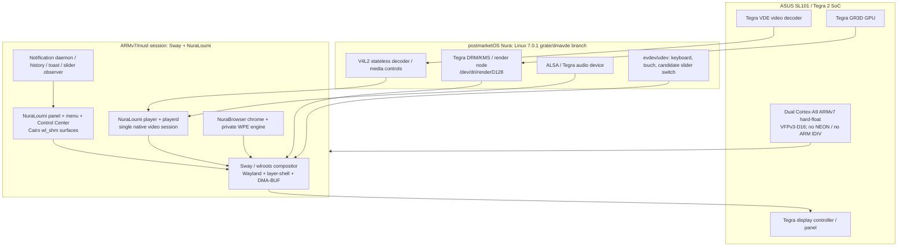
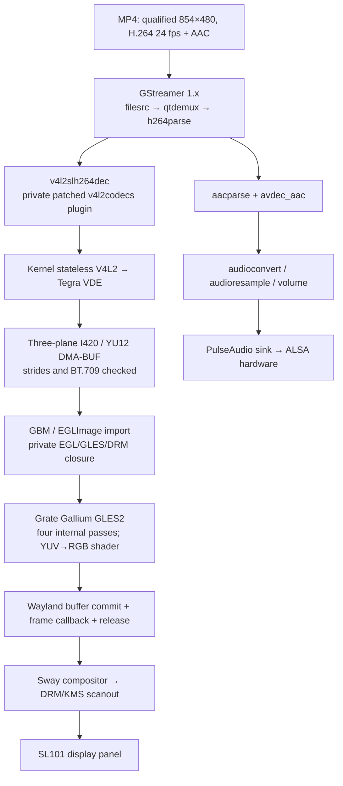
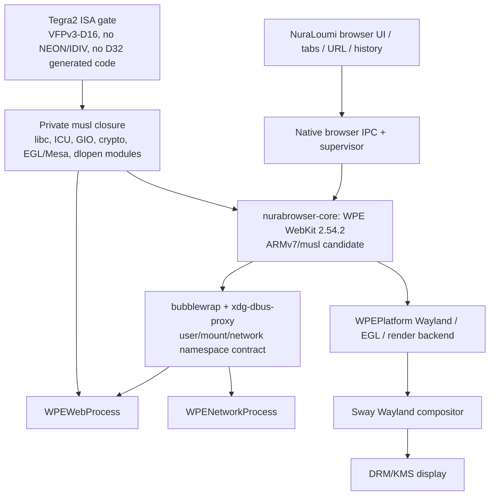
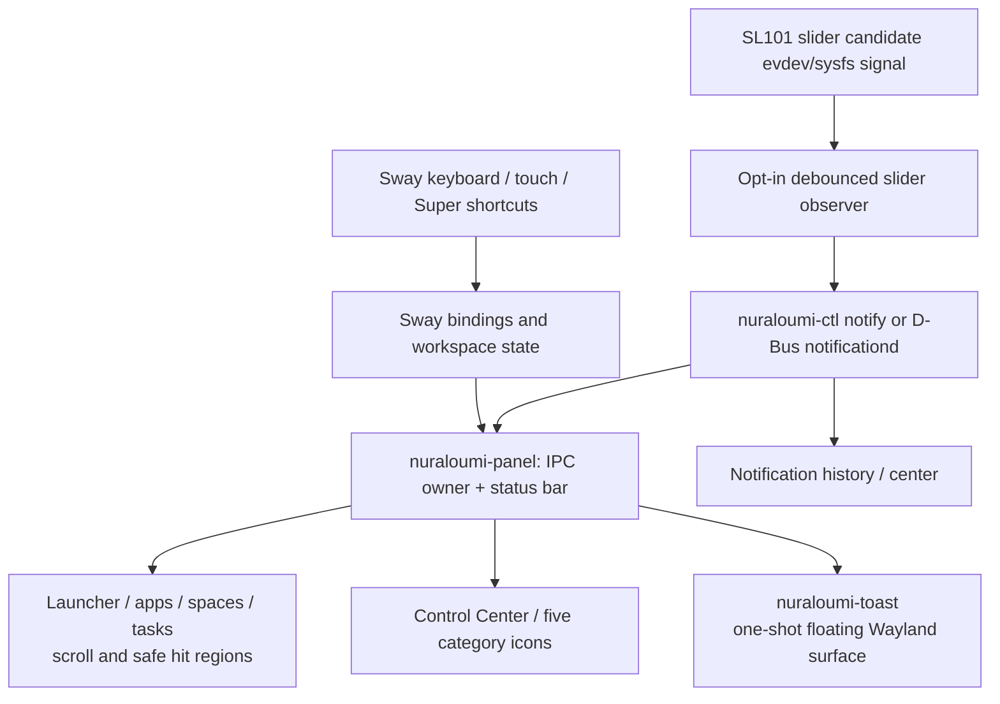
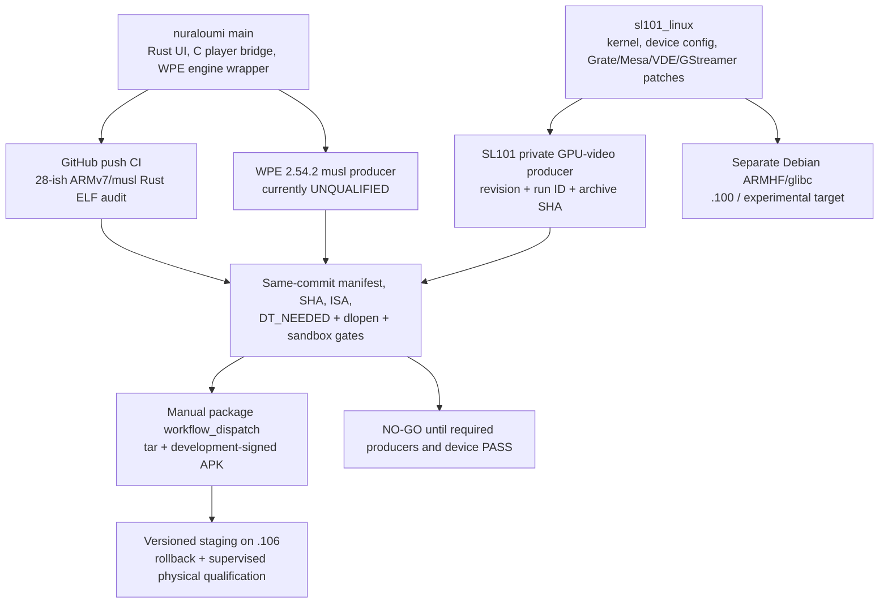

# SL101 ↔ NuraLoumi system landscape — 25 November 2026

This document distinguishes (1) the running postmarketOS/musl tablet, (2) privately staged VDE/GPU/WPE assets, (3) local source and CI, and (4) the separate Debian/glibc experiment. A source file or host test is not an installed/qualified device component.

## 1. Hardware → kernel → compositor → application surfaces

- Sway owns DRM/KMS display composition and modesetting. The native player renders into Wayland-backed buffers; it must not become DRM master or replace Sway.
- Cairo panel/menu text and icon rendering is intentionally independent of video rendering. GPU-video playback does not make the whole desktop GPU-accelerated.
- The actual compositor renderer may select Grate/GLES2 or its safe Pixman fallback; a green desktop screenshot alone cannot establish the renderer or 3D/VDE activity.
- The kernel and EGL/GL userspace are distinct gates. CPU D16-only support restricts both prebuilt shared libraries and JIT/generated instructions (including Mesa/LLVM software paths).

## 2. Native video and audio path — desired private production bundle

| Element | Provenance or gate | State |
| --- | --- | --- |
| Decoder | Tegra VDE stateless V4L2 with private source-patched GStreamer plugin | Private 414-frame stage succeeded historically |
| Buffer transport | DMA-BUF YU12/I420; no CPU YUV map/conversion | Historical stage observed callbacks/releases |
| GPU | Private Grate 0092/0093 lineage, Gallium/Mesa 25.0.7-related producer; system Mesa on device may be 26.2.4 | Version/SONAME and loader provenance must be rechecked on release |
| Audio | AAC into PulseAudio/ALSA; shared pipeline clock | Pipeline EOS proven in historical stage; acoustic lip-sync not |
| Integrated UI | One nuraloumi-player and one nuraloumi-playerd, video-bridge library dynamically loaded | Installed RC2 shows generic failure; precise host-side diagnostics added in 9b9284b |
| Acceptance | 414 frames, EOS, frame callbacks/releases, 24 fps, Pause/Seek/Stop, no SIGILL, sustained memory/thermal | Current installed production player NOT qualified |

The old 414-frame result was from a private no-install stage, not proof that today's /opt/nuraloumi/current loads an identical private runtime. The ordinary musl Rust binary audit does not bundle this dependency tree.

## 3. Browser path — separate WPE/musl process tree

- This WPE runtime is **not** the VDE/GStreamer player. The browser activation code currently forces a software GL path for its private engine (softpipe/swrast); that is not proof of working or accelerated video.
- A local Docker/Ninja build produced a candidate source-pinned to WPE 2.54.2. The D16 crypto overlay removed known ARM ISA risks in selected libraries, but complete decoded ARM/Thumb coverage, dlopen closure, sandbox, WebProcess lifetime and target pixels remain open.
- The first private headless attempts can launch or load some processes yet fail later; an about:blank engine start is not a rendered browser PASS.
- Any LLVM/JIT anonymous-code SIGILL on Cortex-A9 must be traced to the actual mapped object and instruction; do not assume ELF attributes alone prove D16 safety.
- A separate Debian ARMHF/glibc build uses a different ELF interpreter and libc closure. It can inform source portability, but its shared libraries/process helpers cannot be placed inside the musl runtime.

## 4. Session surfaces, notifications and physical inputs

- The menu placement, scroll and font-free category-icon changes have host tests. Device pixels and touch remain unqualified until a source-matched build is installed.
- A notification may be recorded in history even when toast spawning or layer-shell visibility fails. Source fix a0f4287 stops treating unknown notification-center visibility as an automatic toast suppression and adds lifecycle diagnostics; a real floating banner is not yet observed.
- Terminess Nerd Font 3.5.1 candidate covers 35/35 listed Nerd glyphs locally, but its exact-file renderer, license/asset packaging and real panel path are not integrated. Font-free Cairo icons remain the reliable control fallback.
- Slider observer is opt-in, debounced, and does not notify on initial snapshot. The physical switch identity and open/closed polarity have not yet been measured on the SL101.
- Super+Shift+R previously reloaded Sway and invoked a panel wrapper through exec_always; the source-level restart fix lives in sibling sl101_linux, not the media engine. Installed behavior still needs a supervised canary.

## 5. Repositories, ABIs, producers and release gate

**Two release lanes must never be conflated:**

| Lane | Architecture/libc | Package inputs | What it currently proves |
| --- | --- | --- | --- |
| Nura / .106 | ARMv7 hard-float musl, VFPv3-D16 | NuraLoumi binaries + same-SHA WPE runtime + private GPU-video closure | Official pre-UI CI push 623609c is green for 28 text-audited binaries; no complete runtime |
| Debian armhf | ARMv7 hard-float glibc | Debian-specific sysroot, interpreter, WPE/process helpers, appropriate Grate/GStreamer | Separate ABI experiments, not a replacement musl package |
| Host / Docker | x86-64 tools + ARMv7 QEMU | Cross-link and private producer candidates | Source/ELF/host tests, not physical KMS/VDE/Wayland qualification |

**Gate sequence:** exact Git SHA and producer revisions → download official artifacts → independently hash actual bytes → reject wrong libc/ISA/SONAME/RPATH/transitive dlopen → verify WPE sandbox and VDE/GPU on the physical tablet in a versioned inactive stage → record rollback hashes → only then activate an RC. A push artifact marked AUDIT-ONLY-NO-DEPLOYMENT is never a release tar or device-qualification PASS.

## Key evidence

- docs/qualification/SL101-NURALOUMI-PROGRESS-20261125.md — dated status, commits, tests and blockers.
- docs/qualification/SL101-RC2-DEPLOY-GATE-20261125.md — official CI/source-matching and SSH no-go.
- docs/qualification/NURABROWSER-LOCAL-MUSL-CANDIDATE-20261125.md — private WPE/crypto source and ISA preflight.
- docs/qualification/NURALOUMI-PLAYER-E2E.md — historical private 414-frame VDE/GPU integration.
- docs/qualification/SL101-GPU-BUNDLE-CI.md — GPU producer and package contract.
- docs/qualification/MUSL-GITHUB-CI.md — updated push versus release artifact rules.
- docs/qualification/SL101-PANEL-RESTART-20261125.md — Sway restart source and supervised canary.
